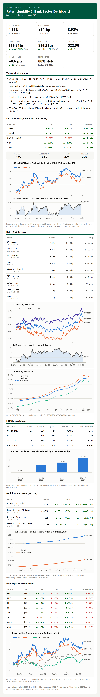

# Weekly Rates & Banking Dashboard

`bank_dashboard` pulls rates, Fed balance sheet data and bank equity prices,
computes week-over-week (WoW) and quarter-over-quarter (QoQ) changes, renders
charts, and emails a responsive HTML briefing. 

## Personalization

It uses **EBC**
bank, as the sample subject and compares it with a selection of peers. To analyze
a different bank, change `SUBJECT_TICKER` in `bank_dashboard/config.py`.

## What's in the report

| Section | Metrics | Source |
|---|---|---|
| Rates & curve | 2Y / 10Y / 30Y UST, full 1M–30Y curve, 2s10s, 3m10y, 30Y mortgage | FRED (H.15, Freddie Mac PMMS) |
| Funding | SOFR, EFFR, fed funds target range, SOFR–EFFR spread | FRED (NY Fed) |
| FOMC expectations | P(cut / hold / hike) and implied EFFR for the next 4 meetings | CBOT 30-Day Fed Funds futures (Yahoo) |
| Bank balance sheets | Deposits, loans & leases (all banks and small banks) | FRED (Fed H.8, weekly, SA) |
| EBC vs KRX | EBC vs the KBW Nasdaq Regional Banking Index: 1W, 1M, QoQ, YTD and 1Y returns with the relative spread; 1Y beta, correlation and volatility | Yahoo Finance |
| Equities | EBC, KRX, KRE, KBE, XLF, SPY + peers: 1W / QoQ / YTD price return, distance from 52-week high | Yahoo Finance |

Charts: Subject bank vs KRX (indexed, plus a relative-return panel), Treasury yields with a 2s10s panel, the yield curve now vs 1 week and
1 quarter ago, deposits vs loans, 1-year bank equity
performance, and the implied fed funds path.

**About the series:** the dashboard uses the weekly H.8 series
`DPSACBW027SBOG` (deposits) and `TOTLL` (loans) rather than the monthly
`DPSACBM`, because WoW changes need weekly data. H.8 data runs about 9 days
behind (it is released on Fridays for the week ending the prior Wednesday),
and each row shows its own "as of" date.

## Project structure

```
bank_dashboard/
├── __main__.py   entry point for `python -m bank_dashboard`
├── cli.py        argument parsing, logging setup, exit codes
├── pipeline.py   orchestration: fetch -> compute -> render -> deliver
├── config.py     FRED series, tickers, FOMC calendar, env-driven Config
├── sources.py    FRED API client and Yahoo Finance prices
├── analytics.py  WoW / QoQ metrics, equity returns, beta
├── fomc.py       FOMC probabilities from 30-Day Fed Funds futures
├── narrative.py  rule-based "this week at a glance" bullets
├── charts.py     Matplotlib charts
├── report.py     table-based HTML email and plain-text fallback
├── mailer.py     SMTP delivery with inline images
└── theme.py      shared color palette
```

## Setup

```powershell
cd bank_dashboard
python -m venv .venv
.\.venv\Scripts\pip install -r requirements.txt
```

Then fill in `.env` (copied from `.env.example`):

### 1. FRED API key (required, free)
1. Create an account at <https://fredaccount.stlouisfed.org/login>.
2. Request a key at <https://fred.stlouisfed.org/docs/api/api_key.html>. It is issued right away.
3. Set `FRED_API_KEY=` in `.env`.

### 2. SMTP credentials
| Provider | Host | Port | `SMTP_USE_SSL` | Notes |
|---|---|---|---|---|
| Gmail | `smtp.gmail.com` | 587 | false | Needs 2FA plus an [App Password](https://myaccount.google.com/apppasswords) |
| Office 365 | `smtp.office365.com` | 587 | false | Your tenant admin must allow SMTP AUTH |
| SendGrid | `smtp.sendgrid.net` | 465 | true | User `apikey`, password is the API key |

`EMAIL_TO` and `EMAIL_CC` take comma-separated addresses.

### 3. No other keys needed
Yahoo Finance (equities and Fed Funds futures) needs no key. CME FedWatch has
no free API, so the script reproduces FedWatch's method from the futures
prices itself.

## Run

```powershell
.\.venv\Scripts\python.exe -m bank_dashboard --dry-run   # build only; open reports\<date>\dashboard.html
.\.venv\Scripts\python.exe -m bank_dashboard             # build and email
```

Run these from the project folder (the one containing `bank_dashboard\`).

**Use the venv's Python.** A bare `python -m bank_dashboard` runs your system
Python, which usually lacks `yfinance`. The report still builds from FRED, but
the equities, subject-vs-KRX and FOMC sections are missing, and the FOMC note
says "Futures unavailable; proxy: ...". To use plain `python`, activate the
venv first (`.\.venv\Scripts\Activate.ps1`), or in VS Code run
"Python: Select Interpreter" and pick `.venv`.

Each run saves `dashboard.html` and the chart PNGs to `reports\YYYY-MM-DD\`.
Exit codes: `0` ok, `1` run or email failure, `2` no data or missing key.

## Schedule weekly

**Windows Task Scheduler** (every Monday at 7:00 AM; replace `C:\path\to\bank_dashboard`):
```powershell
schtasks /Create /TN "Weekly Bank Dashboard" /SC WEEKLY /D MON /ST 07:00 `
  /TR "cmd /c cd /d C:\path\to\bank_dashboard && .venv\Scripts\python.exe -m bank_dashboard >> run.log 2>&1"
```

Recommendation: Monday morning is a good slot. It picks up Friday's H.8 release and Friday's market close.

## Maintenance

- **FOMC calendar:** `FOMC_MEETINGS` in `bank_dashboard/config.py` covers 2026–2027. Each
  summer, add the next year's dates from the
  [Fed's calendar](https://www.federalreserve.gov/monetarypolicy/fomccalendars.htm).
- **Peers:** set `PEER_TICKERS` in `.env`.
- **Subject bank** set `SUBJECT_TICKER` in `.env`. 
- **How the FOMC probabilities work:** each move is treated as a choice
  between two outcomes (for example 25bp cut vs hold), as FedWatch's headline
  numbers do. These figures are indicative and not a trading signal.

## Example

The report from October 26, 2026, made with `--dry-run`:

<details>
<summary>Show the full dashboard screenshot</summary>

<p align="center">
  
</p>

</details>
